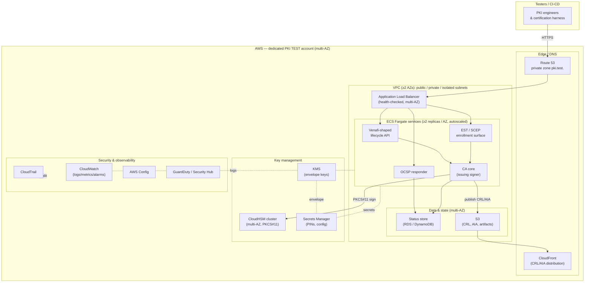
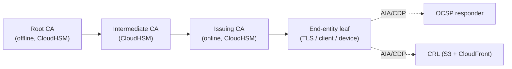
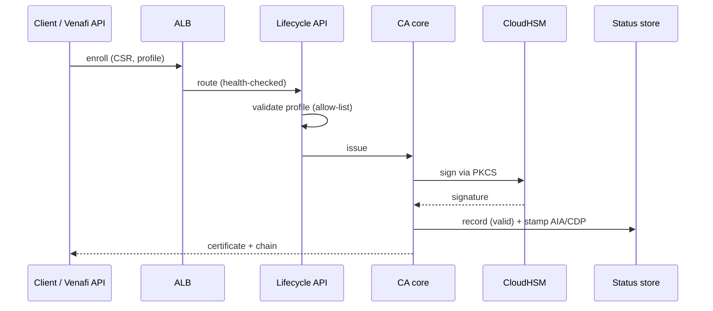
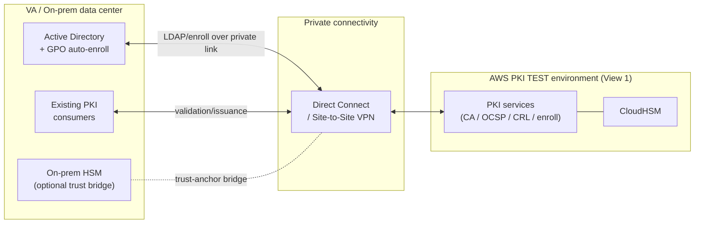

# Architecture — Cloud-First (AWS) Hybrid PKI Test & Certification Environment

> For leadership. Two views: **(1) target AWS all-in architecture** (what we build
> first) and **(2) hybrid extension** (how on-prem/VA connects afterward).
> Diagrams render on GitHub (Mermaid). A standalone, zoomable HTML/SVG version is
> in `diagram.html` for presentations.

---

## View 1 — AWS all-in test environment (Phase A–D)

**Root CA posture:** the Root CA key is held offline (dedicated CloudHSM
partition / exported-and-stored), used only to sign Intermediates and the Root
CRL — never attached to an online issuing service.

### Trust-chain logical view

### Certificate request flow

---

## View 2 — Hybrid extension (Phase F, follow-on)

**Hybrid note:** in Phase A–D everything runs in AWS and the AD/GPO interface is a
stubbed enrollment surface. In Phase F we connect the real VA AD over Direct
Connect/VPN and certify the cross-environment path against the same harness.

---

## Deployment topology (resilience)

- **Multi-AZ** for ALB, ECS services, CloudHSM, and data stores.
- **Autoscaling** on the issuing/OCSP/enrollment services.
- **Ephemeral by IaC:** the whole stack is `terraform apply`/`destroy`; scheduled
  teardown returns idle cost to ≈ $0.

## How to present this to leadership

1. Open `diagram.html` (standalone, no dependencies) for a clean, zoomable visual.
2. Lead with **View 1** (what we build first — all AWS).
3. Use **View 2** to show the hybrid future without implying it blocks the first
   test.
4. Pair with `01-project-plan.md` (the 2-week sprint roadmap) and
   `03-aws-services.md` (the services inventory + cost drivers).
